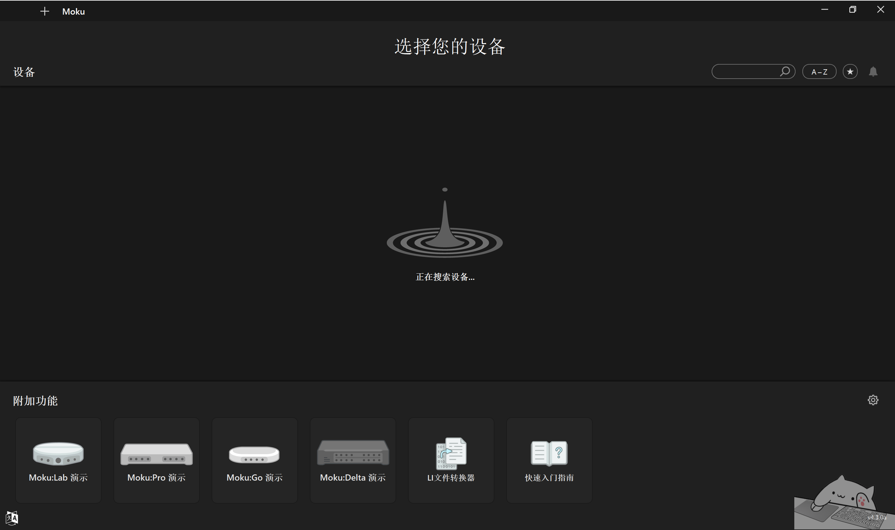
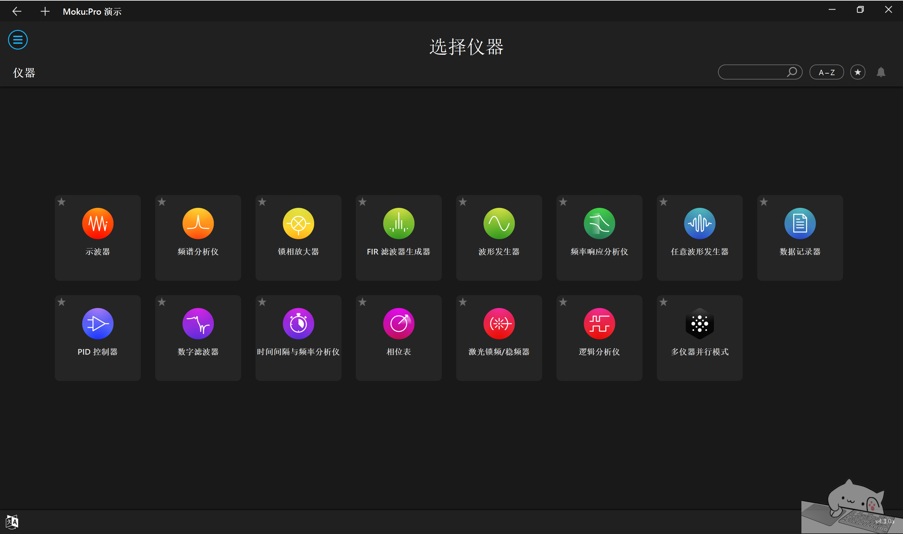

# Moku 软件中文操作手册

**本机 Windows 版 v4.3.0a · 2026-10-13 · 界面功能与操作参考**

本手册面向需要了解 Moku 界面、完成信号测量、信号生成与反馈控制的使用者。它不是 Liquid Instruments 官方出版物；以本机实际界面、安装包中文资源及官方功能资料为依据。

> [!NOTE]
> **适用范围：** 本文记录 Windows 版 v4.3.0a（原文日期：2026-10-13）。不同型号、授权和软件版本的功能可能不同；未经实机验证的内容保留原文说明。

**快速查阅：** [连接设备](#chapter-04) · [仪器操作](#chapter-08) · [多仪器模式](#chapter-22) · [保存与导出](#chapter-25) · [常见问题](#chapter-27)

<a id="contents"></a>

## 目录

<details open>
<summary>展开 / 收起完整目录</summary>

- [阅读导航](#reading-guide)
- [1. 软件](#chapter-01)
  - [演示与真机](#chapter-01-1)
- [2. 操作前的安全检查](#chapter-02)
- [3. 首页：选择您的设备](#chapter-03)
- [4. 连接设备与选择仪器](#chapter-04)
  - [4.1 连接顺序](#chapter-04-1)
  - [4.2 网络功能](#chapter-04-2)
  - [4.3 仪器选择页](#chapter-04-3)
- [5. App 设置](#chapter-05)
- [6. 设备设置与维护](#chapter-06)
- [7. 共用界面与操作](#chapter-07)
  - [7.1 图表与控制](#chapter-07-1)
  - [7.2 输入参数](#chapter-07-2)
  - [7.3 输出参数](#chapter-07-3)
  - [7.4 文件菜单](#chapter-07-4)
- [8. 示波器](#chapter-08)
- [9. 频谱分析仪](#chapter-09)
- [10. 波形发生器](#chapter-10)
- [11. 任意波形发生器](#chapter-11)
- [12. 频率响应分析仪](#chapter-12)
- [13. 锁相放大器](#chapter-13)
- [14. PID 控制器](#chapter-14)
- [15. 数字滤波器](#chapter-15)
- [16. FIR 滤波器生成器](#chapter-16)
- [17. 数据记录器](#chapter-17)
- [18. 相位表](#chapter-18)
- [19. 时间间隔与频率分析仪](#chapter-19)
- [20. 激光锁频／稳频器](#chapter-20)
- [21. 逻辑分析仪与码型发生](#chapter-21)
- [22. 多仪器并行模式](#chapter-22)
- [23. 型号／授权相关扩展](#chapter-23)
  - [23.1 神经网络](#chapter-23-1)
  - [23.2 自定义仪器／自定义仪器+](#chapter-23-2)
  - [23.3 电源](#chapter-23-3)
  - [23.4 SFP／QSFP 数据流](#chapter-23-4)
  - [23.5 在线辅助／生成式仪器](#chapter-23-5)
- [24. LI 文件转换器](#chapter-24)
- [25. 保存与导出](#chapter-25)
- [26. 常用操作实例](#chapter-26)
  - [不接硬件学习](#chapter-26-1)
  - [测真实正弦](#chapter-26-2)
  - [测滤波器频响](#chapter-26-3)
- [27. 常见问题](#chapter-27)
- [28. 覆盖与来源](#chapter-28)
  - [覆盖核对](#chapter-28-1)
  - [官方入口](#chapter-28-2)

- [附件与图片说明](#assets)

</details>

<a id="reading-guide"></a>

## 阅读导航

- [1—4：软件定位、安全、首页与设备连接](#chapter-01)。
- [5—7：App 设置、设备设置和仪器共用操作](#chapter-05)。
- [8—21：Pro 演示页的 14 种仪器](#chapter-08)。
- [22：多仪器并行模式与信号路由](#chapter-22)。
- [23—25：扩展功能、文件转换与数据导出](#chapter-23)。
- [26—28：操作实例、故障排查、覆盖核对与资料来源](#chapter-26)。
- 界面词条索引：原文提及的独立附件，本次未随文件提供；详见[附件与图片说明](#assets)。

[返回目录](#contents)

---

<a id="chapter-01"></a>

## 1. 软件

Moku 软件配合 Liquid Instruments 可重配置硬件使用。电脑负责仪器选择、配置、显示和文件管理；模拟输入输出与实时运算发生在硬件上。仅安装软件不会让电脑自身拥有示波器的物理输入输出。

<a id="chapter-01-1"></a>

### 演示与真机

演示适合学习控件与观察模拟信号，不能验证线缆、端口电压、噪声、网络吞吐或闭环稳定性。资源明确提示：演示模式不能保存高分辨率采集数据。模拟曲线不是实验数据。

[返回目录](#contents)

---

<a id="chapter-02"></a>

## 2. 操作前的安全检查

1. 查对应型号的最大输入电压、输出范围、端口和终端阻抗，不照搬其他型号数值。
2. 普通 BNC 输入不应直接接市电或高压；使用符合电压等级的隔离、衰减或差分方案。
3. 50 Ω 终端会加载被测电路，注意功率和直流偏置。
4. 配置信号发生器、PID、激光锁定和路由时，先关闭输出；从小幅度、正确偏置与限幅开始。
5. 换仪器、加载配置、恢复默认或更新 MokuOS 可能改变输出并中断记录；先保存数据并让实验安全。
6. 诊断导出可能含设备与网络信息，上传前核对接收方和内容。

[返回目录](#contents)

---

<a id="chapter-03"></a>

## 3. 首页：选择您的设备

> **截图待补充：** 原文引用 `01-home.png`，本次未提供图片文件。

**图 1：本机实见首页。未连接真实设备时显示“正在搜索设备…”。**

| 元素 | 功能与用法 |
| --- | --- |
| 设备区 | 显示发现的硬件；点击设备进入仪器选择。 |
| 搜索框 | 过滤设备或仪器列表；找不到目标时先清空。 |
| A–Z | 排序入口；具体选项以展开菜单为准。 |
| 星形按钮／卡片星标 | 收藏相关入口，方便选择常用项目。 |
| 铃形图标 | 通知入口，通知内容以展开页面为准。 |
| 顶部“+” | 新窗口／会话相关入口；具体选项以本机菜单为准。 |
| 语言图标 | 显示语言相关入口，不改变物理测量参数。 |
| 附加功能齿轮 | App 设置入口。 |
| 四种设备演示 | 不连接硬件学习相应型号界面。 |
| LI 文件转换器 | 处理设备记录的 LI 文件，详见[第 24 章：LI 文件转换器](#chapter-24)。 |
| 快速入门指南 | 打开设备入门资料；部分型号有随附中文 PDF。 |
| 版本文字 | 本机显示 v4.3.0a。 |

[返回目录](#contents)

---

<a id="chapter-04"></a>

## 4. 连接设备与选择仪器

<a id="chapter-04-1"></a>

### 4.1 连接顺序

1. 给设备供电，等待启动。
2. 按型号快速入门指南，通过以太网、设备 Wi-Fi 或受支持的 USB 连接电脑。不是每个型号都支持所有方式。
3. 打开 Moku 等待发现设备；若提供手动地址连接入口，可用设备实际 IP。
4. 点击目标，核对名称和型号，避免控制实验室另一台设备。
5. 如提示占用，先与当前使用者协调，不抢占或中断实验。
6. 点击仪器卡片，等待部署，再检查输入和输出状态。

<a id="chapter-04-2"></a>

### 4.2 网络功能

| 项目 | 作用与提醒 |
| --- | --- |
| 以太网 | 有线控制；支持时配置 DHCP 或静态 IP。地址和子网要匹配实验网络。 |
| 加入 Wi-Fi | 设备连接现有无线网络；输入正确 SSID 和凭据。 |
| 创建 Wi-Fi | 支持设备可作为接入点；建议设密码。 |
| USB | 支持型号的直连方式；资源提示 Web 界面不适用于 USB。 |
| 网络配置加载 | 仅在实际页面提供时使用；更改后可能断开并重新发现。 |

资源警告：Wi-Fi 与以太网同时接同一网络可能使连接不可靠。不要盲目同时启用全部接口。

<a id="chapter-04-3"></a>

### 4.3 仪器选择页

> **截图待补充：** 原文引用 `02-pro.png`，本次未提供图片文件。

**图 2：Moku:Pro 演示页全部 15 张入口卡片。**

实见示波器、频谱分析仪、锁相放大器、FIR 滤波器生成器、波形发生器、频率响应分析仪、任意波形发生器、数据记录器、PID 控制器、数字滤波器、时间间隔与频率分析仪、相位表、激光锁频/稳频器、逻辑分析仪和多仪器并行模式。

左上三横线打开菜单，返回箭头回上一级。卡片星标用于收藏；搜索和排序帮助定位仪器。其他型号或授权可能有不同列表。

[返回目录](#contents)

---

<a id="chapter-05"></a>

## 5. App 设置

App 设置改变软件偏好，不等于改变设备电气参数。以下功能名称由本机资源核实，具体设置页随平台变化。

| 功能 | 作用与注意事项 |
| --- | --- |
| 语言 | 更换界面语言；专用名称、外部网页或漏译项可能仍为英文。 |
| 仪器启动设置 | 资源区分“上次使用设置”与“始终默认”；重用旧配置前检查输出使能。 |
| 自动保存设置 | 软件记忆的仪器配置，与测量数据文件不同。 |
| 清除自动保存设置 | 清除上述记忆，不等于删除导出的波形。 |
| 恢复 App 默认 | 可能清除偏好与历史；资源提示不可撤销。 |
| 软件更新提醒 | 提醒桌面应用新版本，与 MokuOS 固件更新不同。 |
| 显示／交互偏好 | 如当前页面提供触控标记、图表行为等，只按其说明使用；视觉缩放不等于采样率变化。 |
| Moku Compile API Key | 云编译认证配置；勿在共享截图中暴露密钥。 |

[返回目录](#contents)

---

<a id="chapter-06"></a>

## 6. 设备设置与维护

真实设备页面未逐项测试，下列名称由资源与资料核对。

| 功能 | 用途与注意事项 |
| --- | --- |
| 设备设置 | 查看／配置当前硬件，先核对操作对象。 |
| 名称与网络 | 改识别和连接方式；网络修改可能导致暂时消失。 |
| 硬件／固件版本 | 排查兼容性时连同 App 版本记录。 |
| 时钟／参考源 | 支持型号可用内部或外部参考，信号条件查硬件指南。 |
| MokuOS 更新 | 更新设备系统；需要稳定供电与连接，会中断测量。 |
| 导出诊断 | 保存排错信息；多仪器资源提示在各运行仪器分别导出。 |
| 仪器手册 | 打开官方说明，是核对参数和复杂选项的首选入口。 |
| 关于／支持／官网 | 版本及服务信息，外部页面可能需要联网。 |

[返回目录](#contents)

---

<a id="chapter-07"></a>

## 7. 共用界面与操作

并非每个仪器都有以下全部功能。先确认仪器，再查对应面板。

<a id="chapter-07-1"></a>

### 7.1 图表与控制

| 功能 | 操作含义 |
| --- | --- |
| 设置侧栏／标签页 | 通道、采集、触发、时基、输出、高级等；隐藏面板不表示停用。 |
| 运行／暂停 | 更新或冻结显示，采集行为依仪器而定；暂停通常不能代替输出关闭。 |
| 单次／武装 | 等待下一次符合条件事件，适合瞬态。 |
| 自动缩放 | 调整显示坐标，不保证输入未饱和。 |
| 拖动／缩放 | 改显示范围；特定模式可能改扫描等参数。 |
| 通道开关／颜色 | 区分与显示轨迹；隐藏显示不一定关闭信号端口。 |
| 参考轨迹 | 保存曲线做比较，不是实时采集。 |
| 光标／标记 | 读取时间、电压、频率、功率、相位及差值。 |
| 测量面板 | 添加测量、统计及趋势，结果取决于来源和窗口。 |
| 重置 | 可能清除参数、光标、测量、参考；先保存。 |

<a id="chapter-07-2"></a>

### 7.2 输入参数

- **DC 耦合**保留直流；**AC 耦合**去除直流并影响低频响应。资源提示 AC 耦合下直流测量可能不准确。
- **量程／衰减**匹配幅度，防止 ADC 饱和；外接探头倍率也须核对。
- **阻抗／终端**改变负载；50 Ω 不是适用于所有信号的默认选择。
- **增益／偏置**可能作用于处理或显示，按具体控件说明区分。
- **饱和警告**出现时减输入或输出幅度、增量程、减处理增益；自动缩放不消除过载。

<a id="chapter-07-3"></a>

### 7.3 输出参数

常见频率、振幅、偏置、相位、终端负载与使能。先认清 Vpp、Vrms 等单位，它们不可直接等值互换。负载设置要与实际终端一致，否则实际电压可能不同。

**关闭窗口、暂停图表或隐藏轨迹不等于关闭输出。** 连接精密器件前检查输出使能、偏置和限幅。

<a id="chapter-07-4"></a>

### 7.4 文件菜单

保存仪器设置用于复现实验；导出数据用于分析，二者不同。加载设置要匹配仪器、型号、版本及单／多仪器模式。显示设置摘要便于记录；导出诊断用于排错。恢复默认会清除部分配置和图表对象，不能假定可撤销。

[返回目录](#contents)

---

<a id="chapter-08"></a>

## 8. 示波器

**用途：** 观察电压随时间变化、捕捉瞬态、测量幅度与时间参数。

| 功能 | 含义与用法 |
| --- | --- |
| 通道 | 选择来源、耦合、阻抗、量程及当前支持的探头选项。 |
| 时基 | 时间跨度与偏移；看几个周期或完整事件，可观察触发前后。 |
| Normal 采集 | 常规观察起点。 |
| Precision 采集 | 通过处理改善精度／噪声表现，不等于无条件提高最高采样率。 |
| Peak detect | 保留采样窗口极值以发现窄脉冲，包络不是所有点同时发生。 |
| Deep memory | 支持时加长记录以兼顾跨度和细节，高分辨率导出需真机。 |
| Auto 触发 | 无有效触发也有显示，先用于找到信号。 |
| Normal 触发 | 等待满足条件；条件不对会无更新。 |
| Single 触发 | 捕获一次事件后停下。 |
| 源、边沿、电平 | 选信号，上升／下降／双边沿，电平置于摆幅内。 |
| Pulse／Runt | 按脉宽或不完整到达阈值的脉冲触发；Runt 不支持外部触发输入。 |
| 迟滞／噪声／高频抑制 | 降低噪声误触发，过强会忽略真实事件。 |
| Holdoff／Nth event | 触发后等待，或第 N 次事件才触发，适合复杂重复信号。 |
| 数学通道 | 对受支持波形运算，核对表达式、单位和带宽。 |
| 自动测量 | 当前列表提供的峰峰值、RMS、频率、周期、边沿等；截断与噪声影响结果。 |
| 光标、参考、直方图 | 手动读数、比较和分布观察，以当前页面提供项为准。 |
| 电压表 | 资源中的辅助面板，是否显示依当前仪器。 |
| 内置输出 | 支持时产生测试信号，需单独确认使能。 |

**流程：** 通道与安全量程 → 时基 → Auto 找信号 → 正确源和电平 → Normal／Single → 添加测量 → 保存轨迹或高分辨率数据及设置。滚动模式下触发可能不可用，资源包含此限制。

[返回目录](#contents)

---

<a id="chapter-09"></a>

## 9. 频谱分析仪

**用途：** 查看能量随频率分布，观察谐波、噪声和杂散。

| 功能 | 用法 |
| --- | --- |
| 频率范围 | 起止频率或中心与跨度，聚焦目标频段。 |
| 分辨率带宽 | 较窄 RBW 可区分相近频率，但存在速度代价。 |
| 窗函数 | 资源包括 Hann、Hamming、Blackman-Harris、Flat top、Rectangular 等；注意泄漏、幅度准确性与分辨率权衡。 |
| 平均／保持 | 平均减波动，最大保持看间歇峰，最小保持看下包络；重置后重新累计。 |
| 纵轴单位 | 当前可选电压、功率、密度和对数表示，确认阻抗与“每 Hz”含义。 |
| 光标／峰值追踪 | 读峰频幅度与差值，支持时设峰为中心频率。 |
| 参考／数学 | 保存比较或运算，不将参考误认成实时输入。 |
| 测量 | 使用当前提供的功率或谐波等项，保证测量带宽覆盖目标。 |
| 输出源 | 支持时生成测试信号，注意使能。 |

**流程：** 输入设置 → 选频段 → 窗与 RBW → 等平均稳定 → 峰值读数 → 导出频谱。超过采样范围的信号可能混叠；模拟带宽大不代表不存在混叠。

[返回目录](#contents)

---

<a id="chapter-10"></a>

## 10. 波形发生器

**用途：** 标准波形、调制、扫频与触发突发。

| 功能 | 用法与约束 |
| --- | --- |
| 波形类型 | 正弦、方波、斜坡、脉冲等当前选项，各类型频率上限可能不同。 |
| 频率、振幅、偏置、相位 | 配置周期、摆幅、直流中心和相对时序。 |
| 占空比／脉宽／对称性 | 对应波形才显示，改变形状。 |
| 负载／使能 | 与实际终端匹配，显式开关输出。 |
| 同步／相位重置 | 支持时获得可重复的多通道关系。 |
| AM、FM、PM | 幅度、频率、相位调制，选内部／外部等允许源。 |
| PWM | 脉宽调制，资源提示仅用于脉冲波形。 |
| Sweep | 配置起止频率、时间和规律，不等于测量传递函数。 |
| Burst | 触发后有限周期或门控输出，设置源及数量／时长。 |
| 手动触发 | 门控突发不允许手动触发，以当前模式限制为准。 |
| 通道复制 | 复制另一输出设置后仍检查使能、相位和负载。 |

**安全流程：** 关闭输出 → 正弦／小幅度／正确偏置 → 负载 → 接线 → 使能 → 独立测量确认。避免循环调制依赖。

[返回目录](#contents)

---

<a id="chapter-11"></a>

## 11. 任意波形发生器

**用途：** 播放自定义采样波形。

| 功能 | 用法 |
| --- | --- |
| 文件导入 | 加载支持的数值文件，确认列、点数和归一化范围。 |
| 公式生成 | 资源明确支持直接输入方程，按界面变量和语法操作。 |
| 点数／采样率 | 影响细节与时间长度，两者存在资源限制。 |
| 周期／频率／振幅／偏置 | 把数据映射到时间与电压，重复频率与点数和采样率相关。 |
| 播放、插值、触发 | 仅按当前实际支持项设置循环、启动和重建方式。 |
| 同步 | 支持时协调多个输出。 |
| 预览／重置 | 检查边界跳变；重置会丢失编辑。 |

**流程：** 导入／方程 → 预览 → 检查点数采样率 → 小幅度和负载 → 使能。资源提示更高采样率可能限制点数和输出电压。

[返回目录](#contents)

---

<a id="chapter-12"></a>

## 12. 频率响应分析仪

**用途：** 扫频激励并测增益与相位响应。

| 功能 | 用法 |
| --- | --- |
| 激励 | 设置输出幅度、偏置和通道，不让系统进入非线性区。 |
| 扫频 | 起止、点数、线性／对数分布。 |
| 参考／响应输入 | 比较激励与系统输出，不接反。 |
| 稳定时间／周期 | 每点等待稳定，高 Q 或慢系统需加长。 |
| 平均时间／周期 | 降噪但延长扫描。 |
| 动态振幅 | 饱和时自动减输出，资源说明可提高动态范围；仍需安全上限。 |
| 归一化 | 保存基线进行比较／补偿，改线后重新确认。 |
| 幅频／相频／光标 | 读增益、截止、共振和相位，保持单位与参考一致。 |
| 开始／停止 | 中止扫描的数据可能不完整。 |

**流程：** 输出接系统输入、参考看激励、响应看输出 → 小幅试扫 → 检查饱和 → 调稳定和平均 → 正式扫描 → 保存。仅看增益不能判断全部闭环稳定性。

[返回目录](#contents)

---

<a id="chapter-13"></a>

## 13. 锁相放大器

**用途：** 按参考频率解调微弱信号，提取正交分量或幅相。

| 功能 | 用法 |
| --- | --- |
| 信号输入 | 耦合、量程、增益，保证解调前未饱和。 |
| 解调源 | 资源含内部正弦、输入 2、输入 2 PLL、支持模式的调制信号。 |
| 频率／相位 | 校准内部参考，调相位使目标分量落到 X／Y。 |
| PLL | 频率、自动频率、环路带宽等，外参不稳定会影响结果。 |
| 低通 | 截止／时间常数和斜率，窄带抑噪但响应慢。 |
| X/Y、R/θ | 正交分量与幅度／相位；输出选项依模式。 |
| 输出增益／偏置／路由 | 把滤波或支持信号送到端口。 |
| 辅助 PID | 资源含主／辅助输出 PID，仅适用于允许的滤波信号。 |
| 监测点 | 查看输入、内部处理和输出。 |

**流程：** 信号与参考 → 选源校频 → 较宽低通起步 → 调相位 → 等待稳定 → 缩窄带宽 → 选输出。外部解调和第二路滤波输出存在模式限制，按提示处理。

[返回目录](#contents)

---

<a id="chapter-14"></a>

## 14. PID 控制器

**用途：** 处理误差信号形成反馈。

| 功能 | 用法与注意事项 |
| --- | --- |
| 控制矩阵 | 输入组合成误差，符号决定反馈方向。 |
| P | 即时响应，过大可能振荡。 |
| I | 抑制稳态误差，过强会积累或慢振荡。 |
| D | 增强高频响应／相位超前，也可能放大噪声。 |
| 增益／角频率形式 | 若按频域曲线配置，不能把参数直接当传统 Kp/Ki/Kd。 |
| 积分／微分饱和 | 资源含饱和水平和角频率，用来限制频域增益，不直接等同于端口电压限幅。 |
| 偏置／输出限制 | 若提供，设工作点与执行器安全范围。 |
| 使能／旁路 | 旁路与输出关闭不同。 |
| 监测 | 检查误差与控制输出是否饱和。 |

**调试：** 输出关闭 → 查符号和限幅 → 小 P、暂不加 I/D → 低幅启用 → 确認方向 → 调 P，再加 I 和必要的 D → 保存。误差放大、振荡或顶住限幅时先关闭反馈，不继续加增益。

[返回目录](#contents)

---

<a id="chapter-15"></a>

## 15. 数字滤波器

**用途：** IIR 等滤波处理。

| 功能 | 用法 |
| --- | --- |
| 输入／矩阵／路由 | 指定信号和输出，检查方向。 |
| 形状 | 资源含低通、高通、带通、带阻、自定义。 |
| 类型 | 资源含 Butterworth、Chebyshev I/II、Elliptic、Bessel、Cascaded 等，不代表各仪器都有全部。 |
| 频率／带宽／阶数 | 决定通带与滚降，受采样配置约束。 |
| 增益／偏置 | 留意内部及输出饱和。 |
| 频域／时域设计 | 比较延迟、滚降、振铃，不能只看理想响应。 |
| 自定义系数 | 按当前格式导入，验证稳定性和量化。 |
| 监测 | 对比输入与滤波输出。 |

资源描述一种格式为每行 6 个参数的级联节，缩放如需使用放首行。**不要把它与 FIR 系数格式混用；服从当前对话框说明。**

[返回目录](#contents)

---

<a id="chapter-16"></a>

## 16. FIR 滤波器生成器

**用途：** 有限冲激响应滤波及定制幅相响应。

| 功能 | 用法 |
| --- | --- |
| 滤波设计 | 形状、截止／中心、带宽和窗等实际可选项。 |
| 系数导入 | 资源描述逗号或换行分隔的系数文本。 |
| 系数数目／采样率 | 影响响应、延迟与资源，限制依硬件。 |
| 响应预览 | 查看当前提供的频域／冲激响应。 |
| 增益／路由 | 调幅度并送往对应通道。 |
| 监测／使能 | 确认延迟、饱和和滤波效果再启用。 |

有限系数 FIR 不具有 IIR 式反馈不稳定，但错误归一化仍可能造成溢出、大输出或过长延迟。最大系数数目以当前型号界面为准。

[返回目录](#contents)

---

<a id="chapter-17"></a>

## 17. 数据记录器

**用途：** 长时间保存输入数据。

| 功能 | 用法 |
| --- | --- |
| 通道 | 选记录来源、耦合与量程，通道数可能影响速率。 |
| 采样率／抽取 | 决定保存速率，留意抗混叠，不是改显示横轴。 |
| 时间／延迟 | 指定时长与开始时间。 |
| 触发记录 | 受支持时等待事件，条件未满足会继续等待。 |
| 名称／存储 | 用型号提供的内部存储、SD 或其他位置，检查容量。 |
| 预览 | 仅供监测；网络不稳可能有显示间隙，不等于记录丢样。 |
| 开始／停止 | 结束后等待文件写完。 |
| 文件／下载 | 取完整文件再转换。 |

资源提示慢 SD 卡可能不支持持续高速记录，正式长记录前先测试数分钟。等待触发或记录时改配置／启动其他仪器可能终止会话。

[返回目录](#contents)

---

<a id="chapter-18"></a>

## 18. 相位表

**用途：** 跟踪音调相位、频率和幅度，分析稳定性。

| 功能 | 用法 |
| --- | --- |
| 输入／中心频率 | 来源和频率靠近目标信号。 |
| PLL 带宽 | 权衡跟踪速度与噪声，太窄可能跟不上变化。 |
| 自动频率／捕获 | 若提供，协助找信号，仍检查锁定。 |
| 多音调／共享输入 | 资源允许输入 1 送所有相位表通道以跟踪多个音调。 |
| 相位／频率／幅度时序 | 看目标量，注意相位参考与展开定义。 |
| 频谱／Allan deviation | 支持时分析噪声和稳定性，与电压频谱不同。 |
| 记录／保存 | 导出当前允许的时序、频谱或 Allan 数据。 |

资源警告输入频率小于约 10 倍环路带宽可能不稳定，应减带宽。丢失信号、过载或失锁后的相位不能当有效结果。

[返回目录](#contents)

---

<a id="chapter-19"></a>

## 19. 时间间隔与频率分析仪

**用途：** 定义事件并测时间间隔、频率与统计。

| 功能 | 用法 |
| --- | --- |
| 事件源 | 选模拟、数字或受支持外部输入。 |
| 阈值／边沿 | 正确判定事件，按信号设置迟滞。 |
| 开始／停止 | 定义两端点，可能来自不同通道。 |
| 间隔 | 周期、延时、脉宽等当前提供组合，明确是哪两事件。 |
| 采集模式／速率 | 资源说明影响统计、直方图和输出计算。 |
| 统计／直方图／时序 | 看均值、标准差、分布与趋势。 |
| 分辨率／插值 | 若提供，用于时间估计；小数位不是精度保证。 |
| 输出／保存 | 受支持时导出或输出处理量。 |

资源说明停止前有多个开始事件时，从第一个开始事件计时；频率均值与标准差由间隔测量估计。比较数据时保持事件定义相同。

[返回目录](#contents)

---

<a id="chapter-20"></a>

## 20. 激光锁频／稳频器

**用途：** 调制解调与反馈稳定激光到参考目标。

| 功能 | 用法与注意事项 |
| --- | --- |
| 输入／误差信号 | 配置探测、参考、相位和低通，得到正确误差。 |
| 调制 | 频率、幅度和输出；资源警告某些电压限幅不作用于调制信号。 |
| 扫描 | 找目标特征，先设安全扫描电压。 |
| 快／慢 PID | 对不同执行器设置带宽和限幅。 |
| 锁定阶段 | 资源有阶段 1/2/3、增加／移除和状态，先配置再锁定。 |
| Lock Assist | 协助选误差零交叉；选择可能调整输出偏置并启用下个未完全启用阶段。 |
| 同步示波器 | Lock Assist 下触发随扫描；横向交互可能改变扫描偏置和幅度，不仅是时基。 |
| 监测／解锁 | 失锁、饱和或振荡时退出反馈检查。 |

**流程：** 开环看探测 → 安全扫描 → 调误差相位 → 限幅和符号 → 低增益阶段 → 锁定并监测。软件不替代激光安全措施，也不可在执行器极性未知时直接自动锁定。

[返回目录](#contents)

---

<a id="chapter-21"></a>

## 21. 逻辑分析仪与码型发生

**用途：** 数字采集、协议解码和支持端口的码型输出。

| 功能 | 用法 |
| --- | --- |
| 引脚／方向 | 选 DIO 或支持输入，设名字和方向，各型号数量不同。 |
| 阈值 | 支持模拟判逻辑时配置；数字端口电气规格查硬件指南。 |
| 时基／触发／采集 | 定义记录窗口和边沿、组合等条件。 |
| 协议解码 | UART、SPI 等以实际下拉列表为准，设置引脚、时钟、极性、速率、位序。 |
| 数学／光标／测量 | 看逻辑组合与时间关系。 |
| 码型发生器 | 支持时配置 Tick、状态、周期和播放／触发。 |
| 码型 CSV | 资源说明每列为位或引脚，每行为 Tick，0 低、1 高，按对话框映射。 |
| 协议导出 | 至少一个活动解码通道才可保存，解码数据与原始采集不同。 |

确认电压与方向，勿把两个推挽输出直接相连。设置成输入不能保护端口承受任意电压。

[返回目录](#contents)

---

<a id="chapter-22"></a>

## 22. 多仪器并行模式

**用途：** 同一设备上部署多个仪器，通过内部路由构成系统。

| 功能 | 用法 |
| --- | --- |
| 槽位／采样率 | 按型号选择布局，不同组合受资源约束。 |
| 放置仪器 | 选择并放入槽位，不支持组合会提示。 |
| 路由 | 物理输入／槽位输出接槽位输入或物理输出，按方向逐条建立。 |
| 模拟输入／输出／DIO | 在系统层设置物理端口参数，区别于内部数字线。 |
| 部署／同步 | 下发配置并进入当前支持同步状态。 |
| 打开槽位窗口 | 设置各仪器细节，构建器设置结构。 |
| 保存／加载系统 | 复用布局与路由，核对是否含槽位内部参数。 |
| 清空／重置 | 移除所有仪器和路由，重置物理端口设置。 |
| 离开 | 可能关闭槽位窗口并中断系统。 |

不能照搬其他型号槽位数；单仪器全部功能不一定在槽位可用。数字路由有自己的缩放、延迟与限制。资源存在“不包含各槽位设置”提示，必要时分别保存仪器配置。自定义仪器还需比特流；部分组合会降低界面帧率，不等于硬件运算同样变慢。

**学习例：** 放波形发生器与示波器 → 内部路由相连 → 保持物理输出关闭 → 部署 → 各自设参数 → 验证后，如需外部激励，再配置物理输出和负载。

[返回目录](#contents)

---

<a id="chapter-23"></a>

## 23. 型号／授权相关扩展

以下有资源证据，但未在此次 Pro 演示卡片中作为独立入口显示，也未运行验证。

<a id="chapter-23-1"></a>

### 23.1 神经网络

部署按官方格式预先创建、训练和导出的网络，做实时信号推理。资源有加载、层数、神经元与输入输出限制。桌面加载功能不等于通用训练环境。流程：确认型号支持 → 加载正确格式 → 输入输出映射与缩放 → 用已知输入测试 → 再接实验。

<a id="chapter-23-2"></a>

### 23.2 自定义仪器／自定义仪器+

运行由 Moku Compile 创建的 FPGA 比特流；资源有浏览器、API Key、上传、导出及构建信息。选择匹配型号与类型的比特流后部署，核对端口并小幅测试。CI 与 CI+ 比特流不可混用；系统配置缺比特流不能完整恢复。

<a id="chapter-23-3"></a>

### 23.3 电源

资源有 Power supply 与 PPSU，属于支持硬件的可编程电源，不是所有模拟输出都能当电源。本次未核验具体字段与能力。按硬件规格设安全电压和电流限制，核对极性后使能，关闭后改线。

<a id="chapter-23-4"></a>

### 23.4 SFP／QSFP 数据流

资源有发送／接收、IP、UDP 端口、目标 MAC、MTU 和抽取模式。需相应硬件和授权。参数要匹配远端；正常／精确模式样本位宽不同，包内样本数依有效负载计算，接收开始需有效上下文包。具体格式查专用文档，不能从词条推断。

<a id="chapter-23-5"></a>

### 23.5 在线辅助／生成式仪器

资源存在 Generative Instrumentation 和产品问答文字，未确认本机入口，不编造操作路径。在线服务可能发送聊天或配置到服务端；阅读隐私提示，不上传密钥或敏感数据。

[返回目录](#contents)

---

<a id="chapter-24"></a>

## 24. LI 文件转换器

用于把记录文件转成通用分析格式，与保存设置不同。

1. 从首页打开转换器。
2. 选择完整下载的 LI 文件，按页面支持处理单个／多个。
3. 选择当前提供格式和输出目录。CSV、MAT、NPY 是常见分析格式，但本次未逐项确认转换器列表，以实际选项为准。
4. 执行并检查结果，保留原始 LI。
5. 核对时间、通道、单位、采样间隔与样本数。

大文件转换后可能显著增大。不要修改二进制 LI，也不要转换仍在写入／下载的文件。失败先检查完整性、权限、空间与工具版本。

[返回目录](#contents)

---

<a id="chapter-25"></a>

## 25. 保存与导出

下列是整个资源集中的类型，不代表每个仪器全部支持。

| 类型 | 保存内容与注意事项 |
| --- | --- |
| 截图 | 当前可见画面，不替代数值数据。 |
| 设置 | 参数，用于复现，不是波形。 |
| 轨迹 | 图表数据，核对是否仅显示分辨率。 |
| 高分辨率数据 | 支持时读完整记录，演示不可用。 |
| 测量 | 当前测量值，至少一个活动测量。 |
| 测量趋势 | 历史；资源提示测量抽屉可见且有活动测量才可保存。 |
| 频谱 | 记录窗、RBW、平均和单位。 |
| 时序 | 核对时间零点、采样率与间隙。 |
| 统计／直方图 | 记录窗口、事件、重置时刻与箱宽。 |
| Allan deviation | 稳定性分析，不等于普通标准差。 |
| 协议数据 | 解码状态，需活动解码器；最好保留原始逻辑数据。 |

CSV 易检查，MAT／NPY 为二进制分析格式，资源提示不能直接复制到剪贴板。部分数据文件头自动含设置，仍要另记录接线、负载、版本与单位。

**建议归档：** 原始记录、转换数据、仪器与系统设置、截图、App/MokuOS 版本、设备型号、接线负载及实验目的。

[返回目录](#contents)

---

<a id="chapter-26"></a>

## 26. 常用操作实例

<a id="chapter-26-1"></a>

### 不接硬件学习

首页 → Pro 演示 → 示波器 → 查通道、时基、触发、测量和保存 → 改参数观察模拟波形 → 返回。不把演示结果当实验结论。

<a id="chapter-26-2"></a>

### 测真实正弦

查输入额定值与阻抗 → 接输入 → 示波器 DC 和安全量程 → 自动缩放 → 稳定边沿触发 → 加 Vpp、频率或 RMS 等实际可用项 → 检查削顶 → 导出数值和设置。

<a id="chapter-26-3"></a>

### 测滤波器频响

输出关闭 → 正确接激励、参考和响应 → 频响分析仪 → 低幅、频段、点数 → 足够稳定／平均 → 扫描 → 检查饱和与连续性 → 调小幅度或动态振幅 → 保存增益相位与设置。

[返回目录](#contents)

---

<a id="chapter-27"></a>

## 27. 常见问题

| 现象 | 检查与处理 |
| --- | --- |
| 搜索不到 | 电源、同网、网卡、过滤与防火墙权限；不要关闭整个防火墙。 |
| 被占用 | 协调其他窗口／电脑，不抢占或升级。 |
| 部署失败 | 型号、授权、App/MokuOS 兼容与资源完整性；不替换 .bar 文件。 |
| 无波形 | 接线、通道、量程、耦合、触发；先 Auto，不盲目升幅度。 |
| 顶平／饱和 | 增量程、降信号、偏置或增益；缩放无用。 |
| 电压不符 | 单位、负载、终端、偏置和使能。 |
| 扫频不稳 | 参考接线、稳定时间、平均、过载和非线性。 |
| 相位跳动 | 参考频率、锁定、幅度、带宽与相位定义。 |
| 闭环振荡 | 先安全关闭反馈，再查符号、增益、延迟和执行器限制。 |
| 记录预览断续 | 查网络，下载原始文件核实，不能只看预览判丢样。 |
| 高分辨率保存失败 | 是否演示、采集完成、有设备连接；截图不替代。 |
| 配置不兼容 | 类型、型号、版本、单／多仪器模式；不改文件绕校验。 |
| 转换／导出失败 | 完整性、权限、空间、其他窗口是否正在导出。 |

[返回目录](#contents)

---

<a id="chapter-28"></a>

## 28. 覆盖与来源

<a id="chapter-28-1"></a>

### 覆盖核对

| 范围 | 章节／状态 |
| --- | --- |
| 首页与 15 张 Pro 演示卡片 | 3—4、8—22：实际截图核实入口和名称。 |
| 仪器内部与通用操作 | 7—22、25：资源与资料核对，未全模式实测。 |
| App、设备、网络维护 | 5—6：名称核实，真机页面未测。 |
| 神经网络、CI、电源、数据流 | 23：资源存在，当前入口和运行能力未核实。 |
| 完整词条 | 原文称附件含 3,000 项，含跨平台项、提示和错误；本次未提供，未核验。 |
| 真实输出／测量／更新 | 未执行，不声明验证成功。 |

**逐按钮未覆盖项：** 各型号设备设置、全部子菜单和模式组合、授权弹窗、真实硬件运行。不能仅靠静态资源认定“所有界面功能均已实测”。本手册解释主要功能，并提供完整词条供检索；精确电气指标、协议格式和系数语法查官方对应手册。

<a id="chapter-28-2"></a>

### 官方入口

- [Liquid Instruments 官网](https://liquidinstruments.com/)
- [官方知识库与用户手册](https://knowledge.liquidinstruments.com/)
- 软件内 **Instrument Manuals…／仪器手册**

公开资料可能比本机版本新。型号相关数值以你的设备规格和当前页面为准，不把各型号最高参数混成通用指标。

[返回目录](#contents)

---

<a id="assets"></a>

## 附件与图片说明

本次提供的源文件仅包含 Markdown 正文。以下资源在原文中被引用，但未随文件提供：

| 资源 | 状态 |
| --- | --- |
| `01-home.png` | 设备首页截图，待补充。 |
| `02-pro.png` | Pro 演示仪器页截图，待补充。 |
| 界面词条索引 | 原文称含 3,000 项，附件名称和内容待核验。 |

补齐截图后，可将图片与本文件放在同一目录，并将正文对应提示替换为以下引用：

```markdown


```

[返回目录](#contents)
